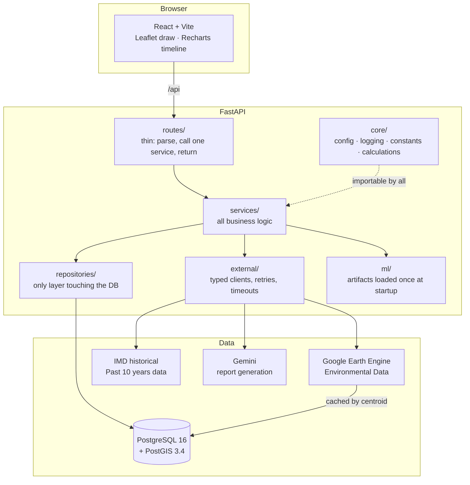

# 🏗️ Building Construction Assistant

> **A tool that recommends optimal construction material ratios for local weather conditions and predicts the building's lifetime using Machine Learning based on 10 years of past data.**

---

## Table of Contents

1. [What Is This Project?](#1-what-is-this-project)
2. [How It Works (Architecture)](#2-how-it-works-architecture)
3. [What You Need Before You Start (Prerequisites)](#3-what-you-need-before-you-start-prerequisites)
4. [Setting Up the Project](#4-setting-up-the-project)
5. [Running the Project](#5-running-the-project)
6. [Verifying That Everything Works](#6-verifying-that-everything-works)
7. [Running the Test Suite](#7-running-the-test-suite)
8. [Machine Learning Models](#8-machine-learning-models)
9. [Known Limitations](#9-known-limitations)
10. [Project Folder Structure](#10-project-folder-structure)

---

## 1. What Is This Project?

The **Building Construction Assistant** is a calculation dashboard and planning tool designed for builders and engineers to use before construction begins. It is not a conversational AI; rather, it is a data-driven utility built to calculate:

> **The optimal material mixture for a specific location, and a data-backed prediction of how long the building will last under local weather conditions.**

### The Problem It Solves

Building structures without accounting for local environmental and weather factors can lead to rapid structural degradation. Standardized building codes often provide generic guidelines, but they may not account for localized weather patterns over time. This tool ensures that the correct material ratios (cement, sand, aggregate, etc.) are used from the start, and it provides a data-backed prediction of the structure's lifetime.

### What You Can Do With It

1. **Select a plot** on a map — the area where you intend to build.
2. **Input basic parameters** — such as the desired structural type and base materials.
3. The system then:
   - Fetches historical weather data (temperature, rainfall, wind) for that location covering the past 10 years.
   - Recommends the optimal ratio mixture (e.g., cement to aggregate) best suited for that specific local climate.
   - Uses Machine Learning to predict the **expected lifetime** of the building in years.
4. You can **swap materials and ratios** to see how they impact the building's predicted longevity.
5. You can **generate a plain-English report** explaining the findings and recommendations, powered by Google Gemini.

### Full Traceability

Every prediction is transparent. Each result includes:
- The historical weather patterns analyzed over the past 10 years.
- The breakdown of recommended material ratios.
- The published sources for the material resistance ratings used.
- The version of each ML model that produced the lifetime prediction.

---

## 2. How It Works (Architecture)

### System Overview



### Technology Stack

| Layer | Technology |
|-------|-----------|
| **Frontend** | React + Vite, with Leaflet for map drawing and Recharts for timelines |
| **Backend** | Python FastAPI |
| **Database** | PostgreSQL 16 with PostGIS 3.4 (for spatial/geographic calculations) |
| **Environmental Data** | Google Earth Engine |
| **Historical Weather** | India Meteorological Department (IMD) API (Past 10 years) + offline fallback |
| **AI Reports** | Google Gemini |
| **ML Models** | Custom-trained scikit-learn models for lifetime prediction and ratio optimization |

### The Strict Layering Rule

The codebase enforces a clean architectural separation that is mandatory, not optional:

- **Routes** only parse incoming HTTP requests and pass them to services — they never touch the database directly.
- **Services** contain all business logic — they never hold a database session themselves.
- **Repositories** are the **only** layer allowed to query the database.
- **External clients** handle all calls to third-party APIs (Earth Engine, IMD, Gemini).

See [CLAUDE.md](CLAUDE.md) for the full list of architectural conventions and recorded design decisions.

### The Scoring Flow (Step by Step)

1. The user draws a polygon on the map.
2. **PostGIS** computes the area and geographic centre (centroid) of that polygon.
3. External clients fetch weather data for that centroid covering the past 10 years. These metrics are cached in the database by location.
4. Environmental stresses are calculated based on the 10-year historical data.
5. The **ratio optimization ML model** calculates and suggests the best material mixture (cement, aggregate, etc.) to withstand those local conditions.
6. The **lifetime prediction ML model** analyzes the selected materials and weather data to predict the building's lifespan in years, including an uncertainty range.
7. The site can be re-calculated with different inputs to compare longevity on the same chart.
8. Google **Gemini** writes a plain-English summary of the recommendations and findings.

---

## 3. What You Need Before You Start (Prerequisites)

### Required Software

| Software | Minimum Version | Notes |
|----------|----------------|-------|
| **Python** | 3.11+ (3.12 recommended) | Used for the backend and ML training |
| **Node.js** | 20+ (built on v24) | Used to run the frontend and developer scripts |
| **Docker Desktop** | Any current version | Runs the PostgreSQL + PostGIS database in a container |
| **Git** | Any current version | Required — model artifact filenames include the commit SHA |

> **Windows users:** `make` is not required. All tasks are available as `npm run` scripts, which work on all platforms including Windows.

---

### API Keys and Credentials

> **The application starts and runs without any of these credentials.** If a credential is missing, the relevant endpoint returns a clear `503 EXTERNAL_SERVICE_UNCONFIGURED` error that names *exactly* which environment variable you need to set. It never silently returns fake or placeholder data.

| Credential | What It Enables | Where to Get It |
|------------|----------------|-----------------|
| `GEMINI_API_KEY` | AI-generated report text | [Google AI Studio](https://aistudio.google.com/app/apikey) (free tier available) |
| Earth Engine service account | Environmental data — **required for predictions** | See detailed steps below |
| Map tiles | OpenStreetMap tiles for the base map | No key needed — OpenStreetMap is free and open |

---

### Setting Up Google Earth Engine (Detailed Steps)

Earth Engine requires three separate things, not just an API key:

**Step 1 — Create or select a Google Cloud project:**
- Go to [https://console.cloud.google.com](https://console.cloud.google.com) and create a project (or use an existing one).
- Enable the **Earth Engine API** for that project.
- Register the project at [https://code.earthengine.google.com/register](https://code.earthengine.google.com/register).

**Step 2 — Create a service account:**
- In your Google Cloud project, go to **IAM & Admin → Service Accounts**.
- Create a new service account and grant it the **Earth Engine Resource Viewer** role.

**Step 3 — Download the JSON key:**
- On the service account page, create and download a **JSON key file**.
- Save it somewhere safe on your machine (note the absolute file path).

**Step 4 — Set environment variables in your `.env` file:**

```env
EARTH_ENGINE_PROJECT_ID=your-gcp-project-id
EARTH_ENGINE_SERVICE_ACCOUNT_EMAIL=your-service-account@your-project.iam.gserviceaccount.com
EARTH_ENGINE_SERVICE_ACCOUNT_FILE=/absolute/path/to/your-key.json
```

---

## 4. Setting Up the Project

Run these steps in order. Each step is explained.

```bash
# 1. Clone the repository
git clone <repository-url>
cd gdg

# 2. Create your local environment file
#    (comes with safe dev defaults; all credential fields are left blank)
cp .env.example .env
# On Windows PowerShell: Copy-Item .env.example .env

# 3. Start the databases
#    (dev database on port 5433, isolated test database on port 5434)
npm run db:up

# 4. Create the Python virtual environment and install backend dependencies
python -m venv backend/.venv

# On Windows:
backend/.venv/Scripts/python -m pip install -e "backend[dev]"
# On macOS / Linux:
# backend/.venv/bin/python -m pip install -e "backend[dev]"

# 5. Install frontend dependencies and root tooling
npm install

# 6. Apply database schema migrations and seed the material catalogue
npm run db:migrate
npm run db:seed

# 7. Train the ML models
#    (only takes a few seconds; trained artifacts are saved to ml/models/)
npm run train:models

# 8. (Optional) Install git pre-commit hooks to block poorly formatted commits
node scripts/py.mjs -m pre_commit install
```

### Why `scripts/py.mjs`?

After step 4, all `npm run` commands that need Python run through `scripts/py.mjs`. This is a small Node.js helper that automatically finds and uses the correct virtualenv Python interpreter, regardless of whether you are on Windows, macOS, or Linux — so all scripts work the same way on every platform.

---

## 5. Running the Project

Open three separate terminal windows and run one command in each:

| Command | What It Starts | URL |
|---------|----------------|-----|
| `npm run db:up` | The PostGIS development and test databases (via Docker) | Ports `5433` / `5434` |
| `npm run dev:backend` | The FastAPI backend with automatic hot-reload on code changes | [http://127.0.0.1:8010](http://127.0.0.1:8010) |
| `npm run dev:frontend` | The Vite frontend dev server | [http://localhost:5173](http://localhost:5173) |

**Interactive API documentation** (Swagger UI) is available at: [http://127.0.0.1:8010/docs](http://127.0.0.1:8010/docs)

---

> ⚠️ **The backend runs on port `8010`, not the usual `8000`.**
> Port 8000 was already in use on the development machine. The Vite frontend is pre-configured to proxy all `/api` requests to port `8010`, so you don't need to change anything on the frontend side.

> ⚠️ **Always use `127.0.0.1`, not `localhost`, when accessing the backend directly.**
> This is a Windows-specific networking issue: `uvicorn` (the Python web server) only binds to IPv4 (`127.0.0.1`), but Windows resolves `localhost` to the IPv6 address (`::1`) first, which causes the connection to fail.

There are no background worker processes or job queues in this application.

---

## 6. Verifying That Everything Works

### Option A: Automated Smoke Test

The quickest way to verify your setup is correct. Open two terminal windows:

**Terminal 1** — start the backend:
```bash
npm run dev:backend
```

**Terminal 2** — run the smoke test:
```bash
npm run smoke
```

#### Expected Output (Without API Keys Configured)

The following output is **correct and expected** when Earth Engine and Gemini have not yet been set up. The `SKIP` lines indicate setup-dependent steps — they are *not* failures:

```
  PASS  backend is live
  PASS  dependency: database
  PASS  dependency: postgis — PostGIS 3.4.3
  PASS  dependency: material_catalogue
  PASS  dependency: ml_models
  PASS  material catalogue
  PASS  submit site polygon (PostGIS)
  PASS  server-computed area is plausible
  SKIP  predict lifetime — earth_engine is not configured
  SKIP  apply suggested ratios — depends on prediction
  SKIP  generate report — depends on prediction

Smoke test passed.
```

Once both Earth Engine and Gemini are fully configured, all steps will report `PASS`.

---

### Option B: Manual Walkthrough in the Browser

Follow these steps to test the full user journey:

1. **Open the app** at [http://localhost:5173](http://localhost:5173).

2. **The map opens.** Find the polygon drawing tool in the **top-right corner of the map** and draw a shape over your desired construction site.

3. **The approximate area** appears below the map. Click **"Use this boundary"**.
   - ✅ *Expected:* `"Saved. Server-computed area..."` — this figure is calculated by PostGIS on the server, not by the browser.

4. **In "Choose materials"**, select your baseline materials (e.g., standard cement, aggregate, etc.).
   - You can expand each material card to see its structural properties.

5. **Click "Calculate Lifetime Prediction".**
   - ✅ *Expected (with Earth Engine configured):* A predicted building lifetime in years, based on the past 10 years of local weather data, along with a confidence label.
   - ✅ *Expected (without Earth Engine configured):* An amber "Setup needed" panel listing the exact environment variables you need to provide. No score is estimated or invented.

6. **Review the recommended ratio mixture.** The system will suggest an optimized ratio (e.g., specific cement-to-aggregate mix) tailored for the local weather.
   - ✅ *Expected:* The predicted lifetime using the recommended ratios should be longer than the baseline.

7. **Click "Generate report".**
   - ✅ *Expected (with Gemini configured):* A four-section plain-English report appears within a few seconds.
   - ✅ *Expected (without Gemini configured):* An amber panel appears indicating that `GEMINI_API_KEY` is not set. No fabricated report is generated.

---

## 7. Running the Test Suite

### Run Everything at Once

```bash
npm run test:all
```

This runs the following checks in sequence:
1. **Linting** — code style checks (ruff)
2. **Strict type checking** — mypy
3. **Backend tests with coverage** — pytest against the real PostGIS test database
4. **Frontend tests** — Vitest

### Before Running Tests, Make Sure:

- The databases are running: `npm run db:up`
- The ML models have been trained: `npm run train:models`
  *(the model-loading tests require real artifact files to exist)*

### Expected Results

```
backend    316 passed
frontend    24 passed
coverage   ~92%   (CI fails if coverage drops below 80%)
```

### Run Individual Parts

| Command | What It Runs |
|---------|-------------|
| `npm run test:backend` | Python backend tests only (pytest) |
| `npm run test:frontend` | Frontend tests only (Vitest) |
| `npm run lint` | Code style checks (ruff) |
| `npm run typecheck` | Static type checking (mypy) |

### No Real Network Calls in Tests

All tests are fully isolated from the internet. An automatic fixture blocks all outbound network connections at the start of every test. Any test that forgets to mock an external API call will **fail loudly** rather than silently hitting a live API. This keeps the test suite fast, deterministic, and safe to run anywhere.

---

## 8. Machine Learning Models

### Training the Models

```bash
# Train both models at once (recommended)
npm run train:models

# Train a single specific model
node scripts/py.mjs ../ml/train_lifetime_prediction.py

# Inspect the synthetic training data without training anything
node scripts/py.mjs ../ml/generate_synthetic_data.py
```

### How Artifact Versioning Works

Trained model files are saved to `ml/models/` with this naming convention:

```
<model_name>_<YYYYMMDD>_<git_commit_sha>.pkl
```

Each `.pkl` artifact has a matching `.json` sidecar file that records performance metrics.

When the backend starts, it **automatically loads the newest matching artifact**. Every prediction records which model version was used, so old predictions remain interpretable even after you retrain. Old artifacts are **never automatically deleted** — retraining adds new files alongside the old ones.

### Evaluating a Newly Retrained Model

After retraining, follow these steps before deploying:

1. Read the R² and MAE values printed during training.
2. Compare them against the metrics in the previous artifact's `.json` sidecar file in `ml/models/`.
3. Run `npm run test:backend` — the core tests check for **monotonicity** (better materials and optimized ratios must *always* produce a longer lifetime) and boundary conditions.
4. Restart the backend — it will automatically load the newest artifact.

---

## 9. Known Limitations

This section is written plainly and honestly, because a tool that informs construction decisions must be transparent about what it does and does not know.

### Data Provenance

**The lifetime prediction model is trained on synthetic data.**
No open public dataset pairs exact material ratios with specific long-term building degradation timelines perfectly. The models are trained on simulated degradation curves based on established structural engineering principles. **These predictions have not been validated against a comprehensive real-world dataset of long-term building collapses.**

**The ratio optimization model is a surrogate.**
The recommended ratios are derived by simulating combinations against the degradation curve. It acts as a fast surrogate for deterministic calculations, not as independent empirical evidence.

**Material properties and historical weather data.**
The tool utilizes historical data from the past 10 years to determine environmental stress. While the past 10 years provide a solid baseline, they may not perfectly capture extreme once-in-a-century anomalies or future climate shifts.

---

### Geographic Coverage and Validation

**Best supported region: Areas with robust historical weather data.**
The accuracy of the lifetime prediction relies heavily on the availability and resolution of the 10-year historical weather data (e.g., from IMD or Earth Engine). In regions with sparse data, the predictions will fall back on broader regional averages, which increases uncertainty.

**The Earth Engine query has not been tested against live credentials.**
The credential guard, response normalisation, timeout handling, and error mapping are all covered by unit tests — but the query shape itself has only been verified against a mock stand-in. **Expect to need one iteration when you first connect to a real Earth Engine account.**

---

### Product Scope

**No user authentication.** Version 1 is anonymous, protected only by per-IP rate limiting and locked CORS headers. Anyone who can reach the API can create sites and generate predictions.

**Rate limiting is per-process (in-memory only).** If multiple backend instances are running, each has its own independent rate limit budget. Redis would be the appropriate upgrade path for shared state across instances.

**Only the exterior ring of a polygon is used.** Building footprints with interior holes (e.g., courtyards) are not supported — inner rings are silently ignored.

**The prediction models the building envelope and core structure.** It does not account for drainage infrastructure, ground conditions (like soil subsidence), neighbouring structures, or building maintenance history.

> ⚠️ **This tool is not a substitute for a professional structural survey, a geotechnical assessment, or formal engineering certification.**

---

## 10. Project Folder Structure

```
gdg/
│
├── backend/
│   └── app/
│       ├── routes/          # Thin HTTP handlers — parse request, call one service, return response
│       ├── services/        # All business logic: sites, weather data, materials, prediction, reporting
│       ├── repositories/    # The ONLY layer allowed to touch the database; ORM models live here
│       │   └── data/        # Material catalogue seed data with sourced ratings
│       ├── schemas/         # Pydantic v2 models — single source of truth for API request/response shapes
│       ├── core/            # Config, logging, constants, exceptions, calculations, rate limiting
│       ├── external/        # Typed API clients: earth_engine, imd, gemini, shared HTTP policy, prompts
│       │   └── data/        # Bundled IMD historical fallback snapshot (used when live API is unavailable)
│       └── ml/              # Model registry (loaded once at startup) + inference wrapper functions
│   ├── tests/               # Mirrors the app/ structure one-to-one; 316 tests total
│   ├── alembic.ini          # Database migration tool configuration
│   └── pyproject.toml       # Python dependencies, linting (ruff), formatting (black), mypy, pytest config
│
├── frontend/
│   └── src/
│       ├── components/ui/        # Shared presentational (display-only) React components
│       ├── components/map/       # Leaflet map + Leaflet.draw for polygon site selection
│       ├── components/timeline/  # Lifetime chart (Recharts)
│       ├── hooks/                # React hooks for data fetching, loading states, and error handling
│       ├── lib/                  # API client, geographic coordinate helpers, formatting utilities
│       ├── types/                # api.generated.ts (auto-generated from OpenAPI schema) + friendly type aliases
│       └── test/                 # Vitest test setup configuration and test guards
│
├── ml/
│   ├── common.py                     # Shared utilities: artifact naming, metrics logging, deterministic seeding
│   ├── generate_synthetic_data.py    # Generates synthetic training data — all assumptions documented here
│   ├── train_lifetime_prediction.py  # Trains the building lifetime regression model
│   ├── train_ratio_optimizer.py      # Trains the material ratio recommendation surrogate model
│   ├── train_all.py                  # Entry point called by `npm run train:models`
│   ├── data/                         # Generated synthetic dataset (produced by training scripts)
│   └── models/                       # Versioned .pkl model artifacts + .json metrics sidecar files
│
├── db/
│   └── migrations/    # Alembic migration environment and all versioned migration scripts
│
├── scripts/
│   ├── py.mjs             # Cross-platform virtualenv Python launcher (used by all npm scripts)
│   ├── generate-types.mjs # Generates TypeScript API types from the backend OpenAPI schema
│   └── smoke_test.mjs     # End-to-end smoke test runner
│
├── docker-compose.yml  # Defines the dev database (port 5433) and test database (port 5434)
├── CLAUDE.md           # Full architectural conventions and recorded design decisions
└── .env.example        # Template for your local environment file — copy this to .env to get started
```

---

*Built to assist with modern, data-driven building construction and lifecycle planning.*
