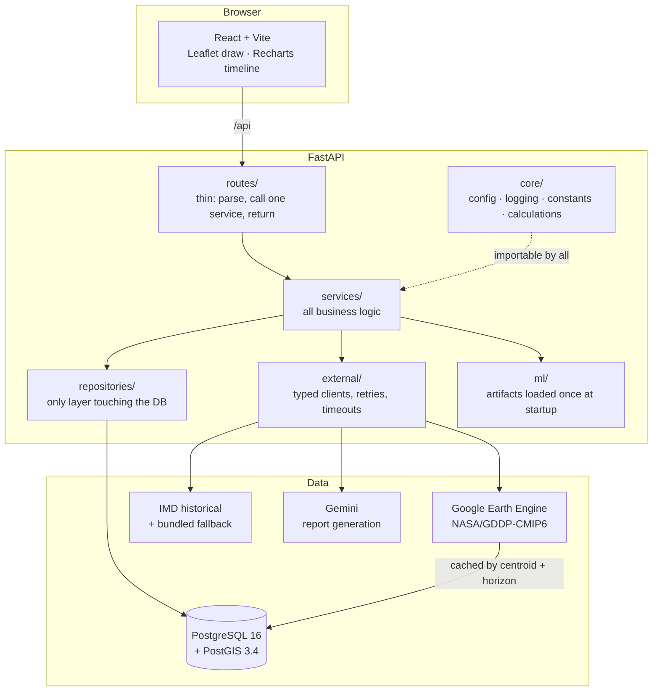

# Climate Lien Score

## 1. Overview

Climate Lien Score answers one question about a building site: **in which year does it
cross the threshold where it becomes uninsurable?** You draw the plot on a map, pick
the materials for its foundation, walls and roof, and the system projects the site's
climate exposure from 2025 to 2055, calibrates that into an expected damage ratio,
and reports the first year that ratio crosses the point at which cover is withdrawn.

The framing is Cyclone Michaung, which flooded Chennai in December 2023. Buildings
that met code were still uninsurable afterwards, because the code they met was
written for a climate that no longer exists. This tool tries to make that visible
*before* the permit is signed rather than after the water recedes — and then shows
what changing the materials would buy, in years.

Every number is traceable. The score response carries the per-year damage curve, the
per-component and per-hazard stress decomposition, the resolved materials with their
published sources, and the versions of the two ML artifacts that produced it.

---

## 2. Architecture



The layering is enforced, not aspirational: routes never touch the database,
services never hold a `Session`, and business code never imports `httpx`. See
[CLAUDE.md](CLAUDE.md).

**Scoring flow.** Polygon → PostGIS computes area and centroid → Earth Engine
returns CMIP6 projections for that centroid (cached) → hazards normalised against
design references → material resistance applied → damage model predicts a ratio per
year with uncertainty → first year over the threshold is the score → the ranking
model suggests better materials → re-score → Gemini writes it up.

---

## 3. Prerequisites

| Requirement | Version | Notes |
| --- | --- | --- |
| Python | **3.12** (3.11+ works) | `requires-python = ">=3.11"` |
| Node.js | **20+** (built on 24) | |
| Docker Desktop | any current | Runs PostgreSQL 16 + PostGIS 3.4 |
| Git | any current | Model artifacts are named with the commit SHA |

`make` is **not** required — every task is an npm script, because `make` is not
available on Windows.

### API keys

The app **starts and runs without any of these.** Endpoints that need a missing
credential return an explicit `503 EXTERNAL_SERVICE_UNCONFIGURED` naming the exact
variables to set. They never return fabricated data.

| Credential | Needed for | Where to get it |
| --- | --- | --- |
| `GEMINI_API_KEY` | Report generation | <https://aistudio.google.com/app/apikey> (free tier) |
| Earth Engine service account | Climate projections — **required for any score** | See below |
| — | Map tiles | None. OpenStreetMap needs no token. |

**Earth Engine** needs three things, not just a key:

1. A Google Cloud project with the Earth Engine API enabled, registered at
   <https://code.earthengine.google.com/register>
2. A service account in that project with the **Earth Engine Resource Viewer** role
3. A downloaded JSON key for that service account

Set `EARTH_ENGINE_PROJECT_ID`, `EARTH_ENGINE_SERVICE_ACCOUNT_EMAIL` and
`EARTH_ENGINE_SERVICE_ACCOUNT_FILE` (an absolute path to the JSON key).

---

## 4. Setup

```bash
git clone <repository-url>
cd gdg

# 1. Environment file. Safe dev defaults; credentials are blank.
cp .env.example .env          # PowerShell: Copy-Item .env.example .env

# 2. Databases (dev on 5433, disposable test on 5434).
npm run db:up

# 3. Backend virtualenv.
python -m venv backend/.venv
backend/.venv/Scripts/python -m pip install -e "backend[dev]"    # Windows
# backend/.venv/bin/python -m pip install -e "backend[dev]"      # macOS / Linux

# 4. Frontend and root tooling.
npm install

# 5. Schema and reference data.
npm run db:migrate
npm run db:seed

# 6. Train the ML models (a few seconds; artifacts land in ml/models/).
npm run train:models

# 7. Optional: block bad commits.
node scripts/py.mjs -m pre_commit install
```

Everything after step 3 goes through `scripts/py.mjs`, which resolves the
virtualenv interpreter on any platform so the npm scripts stay portable.

---

## 5. Running the project

| Command | What it starts | URL |
| --- | --- | --- |
| `npm run db:up` | PostGIS dev + test databases | ports 5433 / 5434 |
| `npm run dev:backend` | FastAPI with reload | <http://127.0.0.1:8010> |
| `npm run dev:frontend` | Vite dev server | <http://localhost:5173> |

API docs are at <http://127.0.0.1:8010/docs>.

> **The backend runs on 8010, not 8000.** Port 8000 was already occupied on the
> development machine. Vite proxies `/api` to 8010, so the frontend needs no change.

> **Use `127.0.0.1`, not `localhost`, when calling the backend directly.** uvicorn
> binds IPv4 only and Windows resolves `localhost` to IPv6 first, which fails.

There are no background workers.

---

## 6. How to validate it works

### Automated

```bash
npm run dev:backend    # in one terminal
npm run smoke          # in another
```

Expected with no API keys configured — note that skipped steps are setup states,
not failures:

```
  PASS  backend is live
  PASS  dependency: database
  PASS  dependency: postgis — PostGIS 3.4.3
  PASS  dependency: material_catalogue — 14 materials
  PASS  dependency: ml_models — damage_model=damage_calibration_...
  PASS  material catalogue — 14 materials
  PASS  submit site polygon — area 20669 sq ft (PostGIS)
  PASS  server-computed area is plausible
  SKIP  score the site — earth_engine is not configured
  SKIP  apply suggested materials — depends on scoring
  SKIP  generate report — depends on scoring

Smoke test passed — 0 failed, 3 skipped.
```

With Earth Engine and Gemini configured, all eleven steps report `PASS`.

### Manual

1. Open <http://localhost:5173>.
2. The map opens over Chennai (13.01 N, 80.27 E). Click the polygon tool, top
   right, and draw a small square over the Adyar estuary area — roughly 40 m a side.
3. The approximate area appears beneath the map. Click **Use this boundary**.
   *Expected:* "Saved. Server-computed area: ~21,000 sq ft" — computed by PostGIS,
   not by the browser.
4. In **Choose materials**, select `Shallow strip footing`, `Fired clay brick
   masonry`, and `Galvanised iron sheet roofing`. Expand a material to see the
   published source its resistance ratings were derived from.
5. Click **Calculate Climate Lien Score**.
   *Expected with Earth Engine configured:* a crossing year between 2025 and 2055,
   a confidence label, a red damage curve crossing the dashed "Uninsurable" line,
   and a table showing which component carries the stress.
   *Expected without it:* an amber "Setup needed" panel naming the missing
   variables. This is correct behaviour — no score is invented.
6. The green line on the same axes is the re-score with suggested materials, and
   **Suggested changes** lists each swap with its reasoning and cost multiple.
   *Expected:* the improved year is the same or later — never earlier.
7. Click **Generate report**. *Expected:* a four-section plain-English summary
   within a few seconds, or an amber panel if `GEMINI_API_KEY` is unset.

---

## 7. Running the test suite

```bash
npm run test:all
```

Runs lint → strict type check → backend tests with coverage → frontend tests.
Requires `npm run db:up` (integration tests use the real PostGIS test database) and
`npm run train:models` (model loading is tested against the real artifacts).

Expected:

```
backend   316 passed
frontend   24 passed
coverage  ~92%   (CI fails below 80%)
```

Individually: `npm run test:backend`, `npm run test:frontend`, `npm run lint`,
`npm run typecheck`.

No test makes a real network call. An autouse fixture blocks outbound sockets, so a
test that forgets to mock something fails loudly rather than reaching the internet.

---

## 8. Model training

```bash
npm run train:models              # both models
node scripts/py.mjs ../ml/train_damage_calibration.py   # one model
node scripts/py.mjs ../ml/generate_synthetic_data.py    # inspect the data only
```

Artifacts are written to `ml/models/` as `<model>_<YYYYMMDD>_<gitsha>.pkl`, each
with a `.json` metrics sidecar. The backend loads the newest matching artifact at
startup and records its version on every score, so an old score stays interpretable.

### Current metrics

| Model | R² | MAE | Train/test |
| --- | --- | --- | --- |
| `damage_calibration` | 0.9355 | 0.0462 damage ratio | 4800 / 1200 |
| `material_ranker` | 0.9891 | 0.0030 damage reduction | 4800 / 1200 |

**Read these honestly.** Both models are trained on synthetic data generated from a
vulnerability curve *we defined*, in `core/constants.py`. A high R² here shows the
model successfully recovered the curve it was shown. **It is not evidence that the
curve describes real buildings.** See `ml/generate_synthetic_data.py`, which says so
at length, and the limitations below.

### Evaluating a retrained model

1. Run training and read the printed R² and MAE.
2. Compare against the previous `.json` sidecar in `ml/models/`.
3. Run `npm run test:backend` — the score-engine tests assert monotonicity
   (stronger materials never score worse) and boundary behaviour, which catch a
   model that fits well numerically but behaves wrongly.
4. Restart the backend. It loads the newest artifact automatically.

Old artifacts are not deleted. Scoring is keyed partly on model version, so
retraining correctly produces new scores rather than replaying superseded ones.

---

## 9. Known limitations

Written plainly, because a tool aimed at permit decisions should be honest about
what it does not know.

**Data provenance**

- **The damage calibration model is trained on synthetic data.** No public dataset
  pairs Indian building specifications with per-building post-cyclone damage ratios.
  The vulnerability curve's exponential form is standard in catastrophe modelling
  and its two anchor points are documented judgements, but **neither has been
  validated against observed Indian damage data.**
- **The material ranking model's labels are derived by simulation** from that same
  curve. It is a fast surrogate for a deterministic calculation, not independent
  evidence about materials.
- **Material resistance ratings are derived, not quoted.** No Indian code publishes
  a 0–1 resistance score. Each entry in `materials_seed.json` names its basis (BMTPC
  *Vulnerability Atlas of India*, IS 875 Part 3, FEMA P-55, ECBC 2017), but the
  mapping onto a 0–1 scale is our judgement and **should be reviewed by a structural
  engineer before informing a real permit.**
- **The IMD fallback dataset is a hand-compiled snapshot**, not an authoritative
  extract. It covers three coastal Tamil Nadu districts. Wind and rainfall figures
  come from named events (Vardah 2016, Thane 2011, Gaja 2018); **the cyclone event
  counts are marked APPROXIMATE in the file itself.** Outside those districts the
  API returns no historical context rather than borrowing a neighbour's figures.
- **`api.imd.gov.in` is not a documented public API.** It is undocumented,
  unversioned, changes without notice and is periodically IP-restricted. The client
  handles it properly and falls back when it cannot be reached.

**Coverage and validation**

- Well supported: coastal Tamil Nadu, which is where the framing and the fallback
  data come from. Elsewhere the CMIP6 projections still work, but the historical
  context and the calibration assumptions are less applicable.
- **The Earth Engine query shape is not verified against the live API.** It was
  written without credentials, so while the credential guard, response
  normalisation, timeout handling and error mapping are all tested, the query
  itself has only been exercised through a stand-in. Expect to iterate on it on
  first contact with real Earth Engine access.
- Only SSP2-4.5 is scored. That choice is deliberate — scoring everything against
  SSP5-8.5 would declare almost every site uninsurable and destroy the tool's actual
  purpose, which is comparing material choices — but a single scenario is still a
  single scenario.

**Product scope**

- **No authentication.** v1 is anonymous, protected by per-IP rate limiting and
  locked CORS. Anyone who can reach the API can create sites and scores.
- **Rate limiting is per process.** State is in memory, so several backend replicas
  each get their own budget. Redis is the upgrade path.
- Behind a reverse proxy the deployment must set `X-Forwarded-For` and run uvicorn
  with `--proxy-headers`, or every client resolves to the proxy's IP.
- Only the exterior ring of a polygon is accepted; footprints with holes are not
  supported.
- The score models the building envelope. It does not model drainage, ground
  conditions, neighbouring structures, maintenance, or occupancy.
- **This is not an insurance decision, a survey, or engineering certification.**

---

## 10. Project structure

```
backend/
  app/
    routes/          Thin HTTP handlers — parse, call one service, return
    services/        All business logic: sites, climate_data, materials, scoring, reporting
    repositories/    The only layer touching the database; ORM models live here
      data/          Material catalogue seed data with sourced ratings
    schemas/         Pydantic v2 models — the single source of truth for API shapes
    core/            config · logging · constants · exceptions · calculations · rate limiting
    external/        Typed clients: earth_engine, imd, gemini, shared http policy, prompts
      data/          Bundled IMD fallback snapshot
    ml/              Model registry (loaded once at startup) + inference wrappers
    tests/           Mirrors app/ one-to-one; 316 tests
  alembic.ini
  pyproject.toml     Dependencies, ruff, black, mypy, pytest, coverage config

frontend/
  src/
    components/ui/        Shared presentational components
    components/map/       Leaflet + Leaflet.draw site selection
    components/timeline/  2025–2055 slider and red-to-green damage chart
    hooks/                Data fetching, loading and error state
    lib/                  api-client · geo (coordinate order) · format
    types/                api.generated.ts (from OpenAPI) + friendly aliases
    test/                 Vitest setup and guards

ml/
  common.py                     Artifact naming, metrics, deterministic seeding
  generate_synthetic_data.py    The synthetic dataset and every assumption in it
  train_damage_calibration.py   Damage ratio regressor
  train_material_ranker.py      Material recommendation surrogate
  train_all.py                  Entry point behind `npm run train:models`
  data/ models/                 Generated dataset and versioned .pkl artifacts

db/migrations/     Alembic environment and versioned migrations
scripts/           py.mjs (venv launcher) · generate-types.mjs · smoke_test.mjs
docker-compose.yml Dev and disposable test PostGIS databases
CLAUDE.md          Conventions and recorded architectural decisions
```
